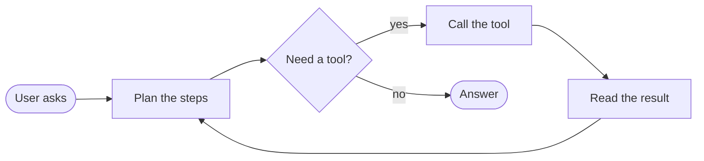
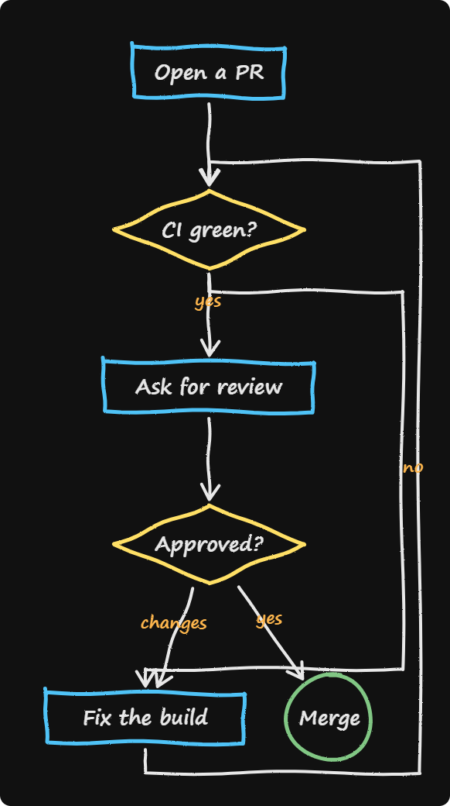
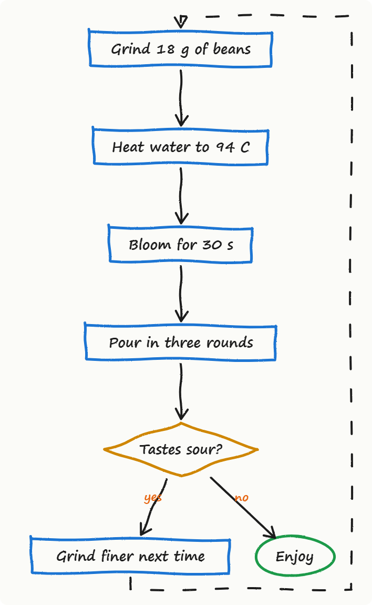
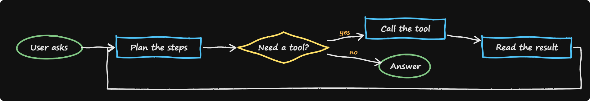

<div align="center">

# chalk-mermaid

**Draw any Mermaid flowchart on a chalkboard, stroke by stroke, as an animated SVG.**

The hand-drawn board of [khan-explainer](https://github.com/haiderfarooq3/khan-explainer) (Khan Academy style videos) meets the diagram syntax of [mermaid](https://github.com/mermaid-js/mermaid). Your flowchart draws itself, box by box, right inside a GitHub README.

 

Works with **Claude Code** and **Codex**.



</div>

The picture above is the real animated SVG from `python chalk_mermaid.py examples/agent-loop.mmd` (reload the page to watch it again). The still images below are the same output at the end of the drawing, screenshotted with `--png`.

## Quick start
```bash
git clone https://github.com/Dodai0419/chalk-mermaid && cd chalk-mermaid
python chalk_mermaid.py examples/agent-loop.mmd -o out
```
```text
chalk-mermaid: agent-loop: 6 nodes, 6 edges, drawn in 8.1 s -> out/agent-loop.svg
```
Open `out/agent-loop.html` for a replay button, or put `out/agent-loop.svg` in any README. Python 3.8+, nothing to install, no browser needed (Chrome or Edge only for the optional `--png`).

The input is plain Mermaid:


## The problem
- Mermaid diagrams are everywhere in READMEs and docs, and they all look the same: static, flat, skimmed past.
- Explainer videos that draw a diagram as they go hold attention, but making one means a video editor or a screen recording.
- Tools that animate diagrams want a browser, a GPU, or a paid account, and their output cannot live in a README.

## The solution
| Idea | Fixes |
|------|-------|
| **Mermaid in** (the same flowchart syntax, checked against mermaid's own parser) | Reuse the diagrams you already have; nothing new to learn |
| **khan-explainer's hand** (the same wobbly `curve`, `oval` and `box`, chalk and marker colours) | Looks drawn by a person, on a blackboard or a whiteboard |
| **Draw in the order of the flow** | Each box is drawn, its label written, then the arrows into it, like a teacher explaining |
| **One self-contained animated SVG** (CSS only, no script) | Plays inside GitHub READMEs, docs sites and slides; respects reduced-motion |

## Gallery

**A pull request, top-down** (`examples/pr-review.mmd`): the "no" path down to "Fix the build" and the loop back to "CI green?" go round the outside instead of through the boxes.



**Pour-over coffee on a whiteboard** (`examples/coffee.mmd --light`), with a dotted "try again" edge:



**How DNS finds a page, left to right** (`examples/dns.mmd`): a thick edge, a database shape and a chain `a --> b --> c` on one line.


**The agent loop, finished board** (`examples/agent-loop.mmd`):



## Options
```bash
python chalk_mermaid.py FILE.mmd -o out           # out/FILE.svg + out/FILE.html
python chalk_mermaid.py README.md -o out          # every ```mermaid flowchart block, FILE-1.svg, FILE-2.svg, ...
python chalk_mermaid.py FILE.mmd --light          # marker on a whiteboard
python chalk_mermaid.py FILE.mmd --speed 1.5      # 1.5x faster drawing
python chalk_mermaid.py FILE.mmd --png            # also the finished board as PNG (Chrome or Edge)
```

Supported: `flowchart` / `graph` in TB, TD, BT, LR, RL; shapes `[ ]`, `( )`, `([ ])`, `[[ ]]`, `[( )]`, `(( ))`, `((( )))`, `{ }`, `{{ }}`, `[/ /]`, `[\ \]`, `[/ \]`, `[\ /]`, `> ]`, quoted labels; edges `-->`, `---`, `-.->`, `==>`, `--o`, `--x`, `<-->`, `o--o`, `x--x`, with `|label|` or `-- label -->`; chains and `&`; compact `A-->B;` lines; `A:::cls` (style ignored). `subgraph`, `style`, `classDef` and `click` lines are skipped (the nodes inside a subgraph are still drawn). Other diagram types (sequence, gantt, ...) are refused with an error.

## Use with Claude Code
```bash
/plugin marketplace add Dodai0419/chalk-mermaid
/plugin install chalk-mermaid@chalk-mermaid
```
Then: "draw our deploy flow as a chalkboard animation for the README".

## Use with Codex (ChatGPT)
```bash
git clone https://github.com/Dodai0419/chalk-mermaid && cp -r chalk-mermaid/skills/* ~/.codex/skills/
```
Or copy `AGENTS.md` into your project root.

## Same output as upstream
- **Parsing:** for the four examples and a syntax sampler (`tests/fixtures/syntax.mmd`: 11 shapes and edge kinds), chalk-mermaid returns the same direction, node ids, labels, shape names and edges (ends, label, stroke, arrow) as mermaid 11.17.2's own `getDiagramFromText` (`bench/mermaid_parse.mjs`, fixture `tests/fixtures/mermaid_parse.json`).
- **Strokes:** `curve`, `oval` and `box` give the same points as khan-explainer's `board.html` (within 1e-5, `bench/khan_shapes.mjs`, fixture `tests/fixtures/khan_shapes.json`).
- **Not the same:** mermaid lays out with dagre and renders crisp SVG; this repo has its own small layered layout (rank by longest path, barycentre ordering, loops routed outside), so positions differ from mermaid.live. khan-explainer renders an MP4 with a voice; this repo renders a silent SVG.

## Benchmarks
Windows 11, Python 3.11.1, Node 24.20.0, mermaid 11.17.2 + jsdom 25 in Node. Three runs each (re-measured 2026-10-27 after the rev1 parser fix; this machine was noisy that day).

| | upstream | this repo |
|-|-|-|
| parse the 4 example flowcharts, in process | mermaid `getDiagramFromText`: 264 / 239 / 200 ms (first call, after import) | `parse`: 1.09 / 1.57 / 1.40 ms (median of 50) |
| whole process for the 4 examples | Node + jsdom + mermaid, parse only: 7.7 / 9.4 / 8.5 s | parse + layout + animated SVG + HTML, one process per file: 1.51 / 3.32 / 2.38 s |
| render the drawing | mermaid: needs a browser (mermaid-cli + Puppeteer, not run here). khan-explainer: needs macOS `say` or espeak-ng, ffmpeg and Playwright Chromium, not runnable on this Windows machine | parse + layout + SVG for all 4 in process: 16.7 / 24.2 / 21.9 ms |
| install size | `npm i mermaid jsdom`: 161 MB of node_modules | one 460-line file, stdlib only |
| lines of code | mermaid flowchart parser + db: 1,995 (`flow.jison` 646 + `flowDb.ts` 1,349); khan-explainer board + renderer: 359 | 460 (`chalk_mermaid.py`) for parse, layout and render |

Commands: `node bench/mermaid_parse.mjs examples/*.mmd` (prints the in-process ms; the whole-process time was taken around it) and `python bench/bench.py`. mermaid's first call includes loading its flowchart module lazily, so its per-diagram cost after warm-up is lower than the number above.

## Inspired by
- [haiderfarooq3/khan-explainer](https://github.com/haiderfarooq3/khan-explainer) — the hand-drawn strokes, chalk and marker palettes, and the idea that the pen draws in the order you explain.
- [mermaid-js/mermaid](https://github.com/mermaid-js/mermaid) — the flowchart language everyone already writes.

## Roadmap
- [ ] Draw subgraphs as a dashed frame.
- [ ] `--gif` export for places that do not play SVG animation.
- [ ] Sequence diagrams.

## License
MIT. Includes MIT-licensed code ported from khan-explainer; follows mermaid's syntax. See NOTICE.
